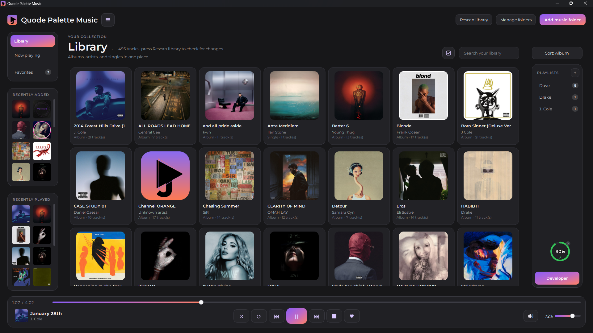
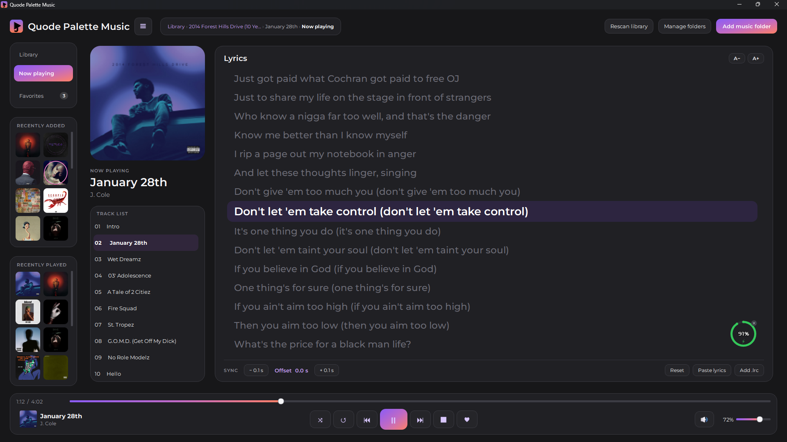
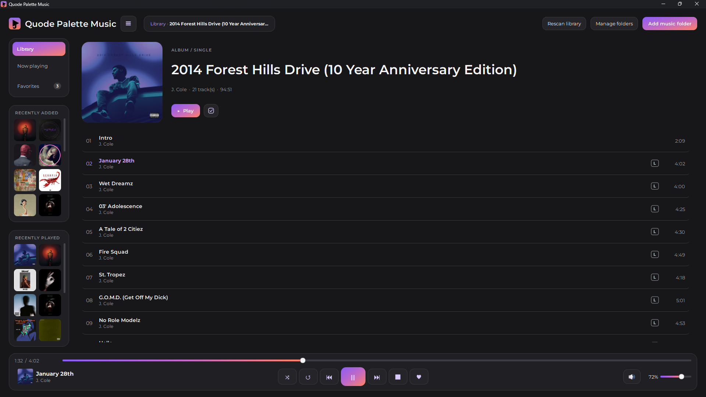

# Quode Palette Music

A clean, fast music player for Windows that puts your albums first.

Select your music folder and start listening. No accounts, no streaming, no clutter. Just your own music, nicely presented.

  
  <b>Screenshot I</b>

<table>
    <td width="50%" align="center">
      
       
      <b>Screenshot II</b>
       
      <!-- Convert common audio formats with FFmpeg -->
    </td>
    <td width="50%" align="center">
      
       
      <b>Screenshot III</b>
       
      <!-- Convert common video formats with FFmpeg -->
    </td>
</table>

## Features

- **Your whole library, organized.** Add one or more folders and your music appears as a grid of albums with cover art.
- **Fast from the start.** Your library loads instantly on launch while new files are picked up quietly in the background.
- **Search and sort.** Find any album, artist, or song in a moment.
- **Full playback control.** Play, pause, skip, seek, shuffle, repeat, and adjust the volume.
- **Favorites and playlists.** Save the songs you love and build your own playlists.
- **Recently added and recently played.** Jump back into what you were listening to.
- **Synced lyrics.** Show lyrics that follow the song, with simple controls to nudge the timing and change the text size.
- **Open files directly.** Double-click a song in Windows and it plays in the window you already have open.
- **Dark design.** Easy on the eyes, with a modern look.

## Supported formats

MP3, FLAC, WAV, M4A, AAC, OGG, OPUS, WMA, AIFF, APE, WV, DSF, and DFF.

## Lyrics

Put an `.lrc` file in the same folder as your song, with the same file name, and the lyrics will appear while it plays.

## Download

Get the latest version from the [Releases](../../releases) page. Two options are available:

- **Setup installer** (`QuodePaletteMusic-Setup-1.0.0.0.exe`): installs the app with a Start menu entry and optional desktop shortcut.
- **Portable ZIP** (`QuodePaletteMusic-Portable.zip`): unzip anywhere and run `QuodePaletteMusic.exe`. Nothing is installed.

## Requirements

Windows 10 or later (64-bit).

## Fonts

The font is under the SIL Open Font License.

## License

Released under the [PolyForm Noncommercial License 1.0.0](LICENSE). You are free to use, modify and share it for personal, educational and other noncommercial purposes. For commercial use, please get in touch.
[Email Us](mailto:hello@quodepalette.com)